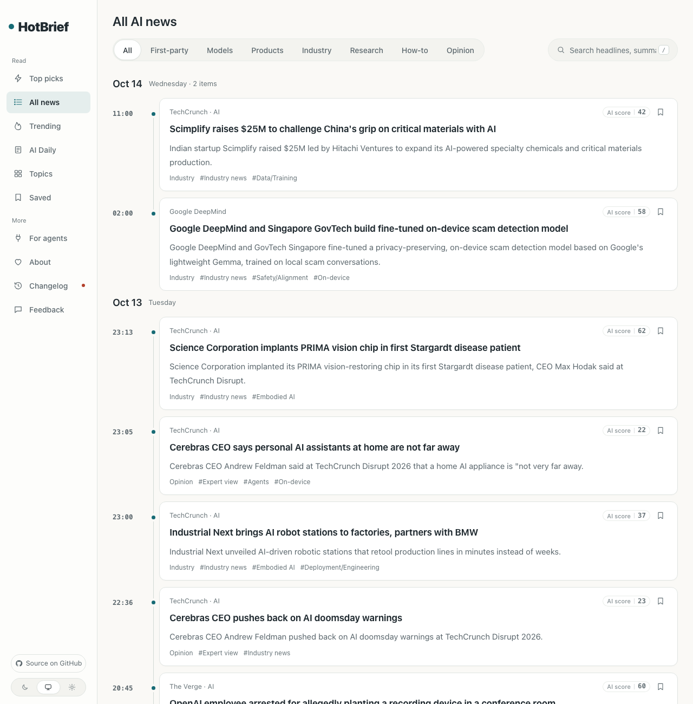

# HotBrief

**[한국어](../README.ko.md)** · English

A news-site engine that watches your sources, picks the AI news worth reading, writes a headline and summary for each, groups reports of the same story, and publishes a daily briefing. Korean and US English editions.

> **Based on [AIHOT](https://github.com/KKKKhazix/AIHOT) by 数字生命卡兹克 (Khazix)** · MIT License · the original `LICENSE` and `NOTICE` are kept as they are.
> What we changed: everything readers see and everything the model writes is in Korean (or US English), and the China-only dependencies (WeChat sources, Alibaba Cloud embeddings, Chinese fonts, Beijing time) are swapped for ones that work in Korea and the US. Details in [`NOTICE.l10n.md`](../NOTICE.l10n.md).

```bash
git clone https://github.com/neulketing/hotbrief.git && cd hotbrief && l10n/apply.sh en-US && node scripts/init-env.ts --llm-key <your model API key> && docker compose up -d --build
```

For the Korean edition, use `l10n/apply.sh ko`. Then open <http://localhost:3000>; the admin is at `/admin`, with the password in `.env` (`ADMIN_PASSWORD`).

**Don’t want to run it yourself?** We host it for you or install it on your servers: [pricing](https://hotbrief-pricing.neulketing.workers.dev/en/).


## Screenshots

Both editions running locally on 2026-10-14 (model: DeepSeek; embeddings: Gemini for the Korean run). Every headline, summary and "why it matters" note was written by the model; in the Korean edition, English sources (Google DeepMind, OpenAI) were rewritten in Korean too.

| Korean edition: home (top picks) | Korean edition: story page |
|---|---|
|  |  |
| **Korean share image (Noto Sans KR)** | **US edition: all news, times in UTC** |
|  |  |
| **Korean daily briefing (nameplate regenerated in Hangul)** | **Korean about page** |
|  |  |

## What it does

1. **Collect** from RSS, web listing pages, JSON APIs and X accounts; busier sources are checked more often.
2. **Pre-screen**: a model checks that an item is about the field and carries real information.
3. **Score twice**, independently, on the same rubric; only items above the threshold for their source tier become top picks. The rubric and thresholds are all in `industry/`.
4. **Write** a headline, an answer-first summary and a "why it matters" note, with a guard that keeps companies the source never mentioned out of the headline.
5. **Group** reports of the same story into one event and rank events by how many independent sources discuss them (Trending).
6. **Publish** a daily briefing (12:00 UTC by default, 8 AM Eastern in summer), a weekly briefing on Mondays and a monthly one on the 1st, plus RSS, a public API, MCP and `llms.txt`.

## What the editions change

No original file is edited. The original author marks `site/` and `industry/` as the place to customize; HotBrief ships replacements for those files plus a patch for the Chinese UI left in the engine code, and `l10n/apply.sh` puts them in place. That keeps upstream updates mergeable.

| Path | Contents |
|---|---|
| `l10n/<lang>/site/site.ts` | Site name (HotBrief), home, about and briefing copy, publishing times, locale |
| `l10n/<lang>/industry/prompts/*.md` | All 29 prompts, rewritten so the model writes Korean or English; rules, scores and thresholds unchanged |
| `l10n/<lang>/industry/taxonomy.ts` | Categories and tags in the target language; Korean companies (Naver, Kakao, LG AI Research, Upstage, Samsung) or US ones (Amazon, Apple, Mistral) added |
| `l10n/<lang>/industry/topics.json` | Topic pages (43 in Korean, 41 in English) |
| `l10n/<lang>/industry/sources.json` | Korean AI news feeds / US AI news feeds, every URL fetched successfully on 2026-10-14 |
| `l10n/<lang>/env.example` | Settings for Korea or the US (time zone, Gemini/OpenAI embeddings) |
| `l10n/patches/<lang>.patch` | Translates the Chinese UI strings in `apps/` and `packages/`, moves the clock to Korea time or UTC, counts sentences in Korean/English summaries, and (ko) loads Korean fonts for share images |

US sources: TechCrunch AI, The Verge AI, WIRED AI, Ars Technica AI, MIT Technology Review AI, The Decoder, Simon Willison, Import AI, Latent Space, plus official blogs from OpenAI, Google DeepMind, Google Research, Microsoft Research, Hugging Face, NVIDIA, AWS Machine Learning, GitHub, Mistral AI and Berkeley AI Research. (VentureBeat's AI feed answered 429 to every request on 2026-10-14, so it's not in the list.)

## China-only dependencies, replaced

| Original | HotBrief |
|---|---|
| WeChat Official Account sources (paid, Dajiala) | Not used; RSS, web listing and JSON API sources instead |
| Alibaba Cloud DashScope (Bailian) embeddings | Any OpenAI-compatible embeddings: Google Gemini `gemini-embedding-001` (free tier, tested) or OpenAI `text-embedding-3-small` |
| Chinese model examples (Qwen, GLM, MiMo) | DeepSeek stays the default; a Gemini preset is added in `site/models.ts`; OpenAI documented |
| Mainland China deployment notes (npm mirror, ICP filing, egress proxy) | Not needed: plain `docker compose up -d --build` |
| Feishu (Lark) push, alerts and login | Off; read alerts with `docker compose logs worker` |
| Noto Sans SC for share images and report nameplates | Noto Sans KR for Korean (pinned, hash-checked download by `apply.sh ko`); nameplates regenerated with `l10n/tools/nameplates.ts` |
| Beijing time (UTC+8) | Korea time (UTC+9, no DST) for ko; UTC for en-US, since US zones change with daylight saving |
| Tencent COS as the default backup host | Set `DB_BACKUP_STORE_DOMAIN` for AWS S3, Cloudflare R2 or another S3-compatible store |

## Install

You need Docker with Compose, Node.js 24+ (to run `init-env`), and an API key for any OpenAI-compatible model API (DeepSeek, Gemini, OpenAI…).

```bash
git clone https://github.com/neulketing/hotbrief.git
cd hotbrief
l10n/apply.sh en-US                               # or: l10n/apply.sh ko
node scripts/init-env.ts --llm-key <key>          # writes .env with random secrets, prints the admin password
docker compose up -d --build
```

- DeepSeek is the default model. For Gemini or OpenAI, change `LLM_BASE_URL`, `LLM_MODEL` and `LLM_EXTRA_JSON` in `.env` as the examples show.
- `l10n/apply.sh en-US --overlay` applies only the copy, sources and prompts and leaves the engine code alone; some UI text and the clock (Beijing time) then stay as in the original.
- The patch also reads zoneless feed times ("2026-10-14 18:23:32", common in Korean feeds) in the edition's usual source zone instead of the server's, and accepts Gemini's OpenAI-compatible embedding responses, which omit `index` (the original engine discarded them; found while running the demo).
- `l10n/apply.sh revert` restores the original files (`git checkout -- site industry .env.example apps packages`).
- Running without Docker, domains and HTTPS, and backups work as in the original [`docs/deploy.md`](../docs/deploy.md) (in Chinese).

## Make it your field

Same as the original: almost everything to change is in `site/` and `industry/`. Start from an edition's files under `l10n/<lang>/`, or edit the applied files directly. With a coding agent (Claude Code, Codex…):

```text
Read AGENTS.md, docs/customize.md and .github/README.md, and turn this site into a news site for the "XX" field.
Edit the files under l10n/en-US/ and apply them with l10n/apply.sh en-US.
What I care about: … (sources to watch, what news matters and what doesn't; the more specific the better)
When you're done, run npm run typecheck, npm test and node scripts/smoke.ts, and tell me which decisions are still mine.
```

The scoring rubric (`industry/prompts/selection-score.md`) and thresholds (`industry/selection.ts`) are worth the most time: label 100–200 items yourself, run `scripts/eval-selection.ts`, and adjust.

## Verification

Run in this repository on 2026-10-14:

| Check | Result |
|---|---|
| `npm run typecheck`, each edition with overlay + patch | Pass |
| `node scripts/smoke.ts` against a running Korean site and a running US site | All checks passed, both |
| `npm test` on the original | 760 of 761 pass (the one failure is a proxy test that depends on this machine's network) |
| `npm test`, Korean overlay only | 749 pass; 11 failures are tests that pin the original AI demo's Chinese tags, topics and titles, plus the proxy test |
| `npm test`, Korean overlay + patch | 731 pass; 30 failures pin Chinese vocabulary, Chinese UI text or Beijing time (UTC+8) |
| `npm test`, US overlay + patch | 720 pass; 41 failures, the same kinds plus tests that expect English bodies to be translated (the US edition leaves English as is) |

The original `AGENTS.md` says to replace the examples in `tests/` when you change the taxonomy. HotBrief doesn't edit original files, so the tests stay as upstream wrote them.

## Staying in sync with upstream

```bash
git remote add upstream https://github.com/KKKKhazix/AIHOT.git   # once
l10n/apply.sh revert
git fetch upstream && git merge upstream/main
l10n/apply.sh en-US     # if the patch no longer applies: git apply --3way l10n/patches/en-US.patch, then regenerate it
```

`node l10n/tools/zh-inventory.ts <original checkout> <patched checkout>` lists the Chinese text still in the engine code; the current list is [`l10n/zh-inventory.md`](../l10n/zh-inventory.md).

## License

The code is under the [MIT License](../LICENSE) (original copyright 数字生命卡兹克). The AIHOT name and logo are not covered by that license, and HotBrief does not use them as its name or logo. Font licenses are in [`NOTICE`](../NOTICE) and [`NOTICE.l10n.md`](../NOTICE.l10n.md).
