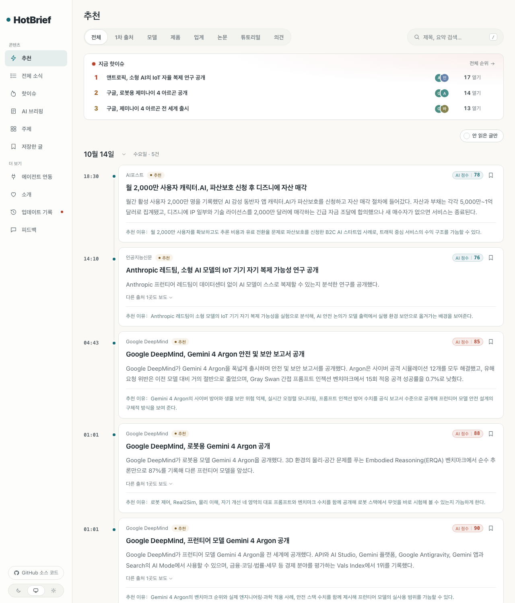
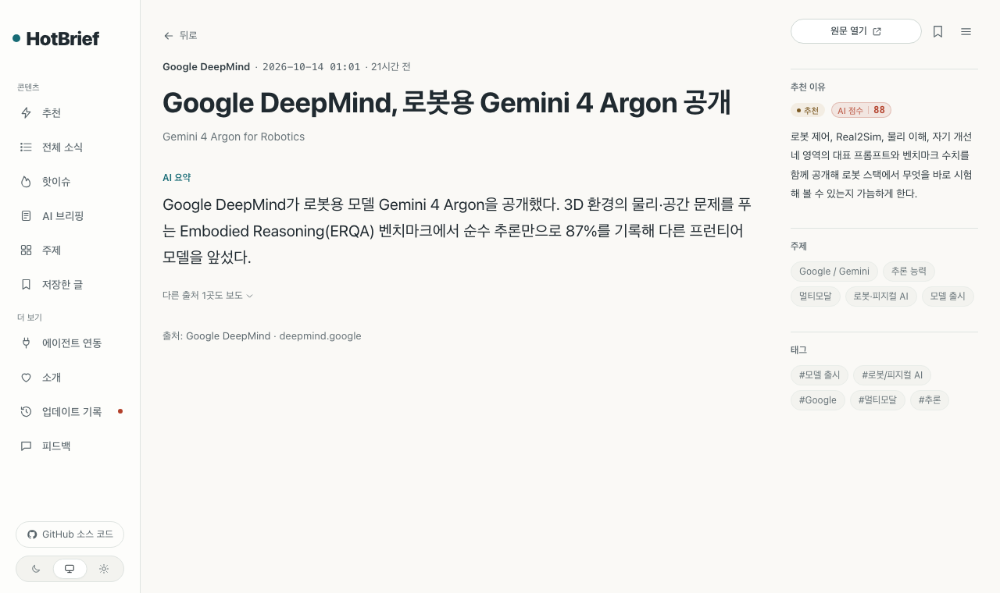
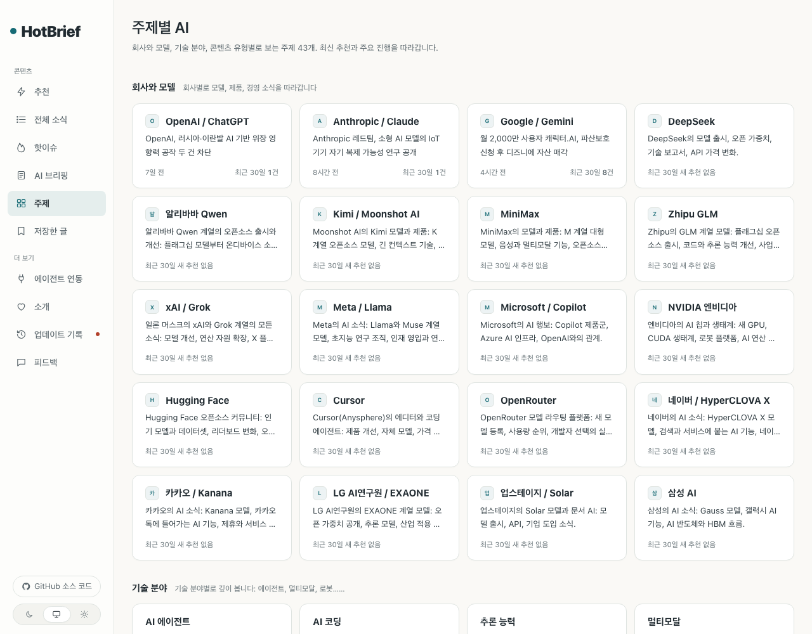
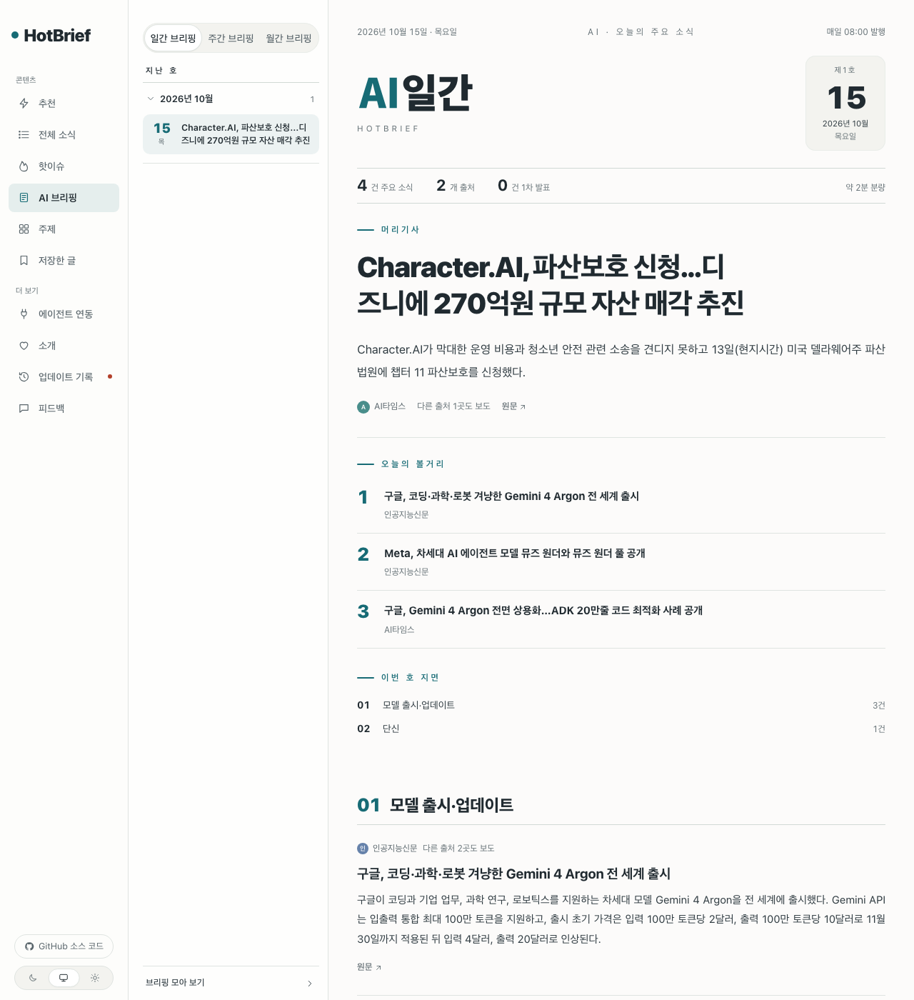
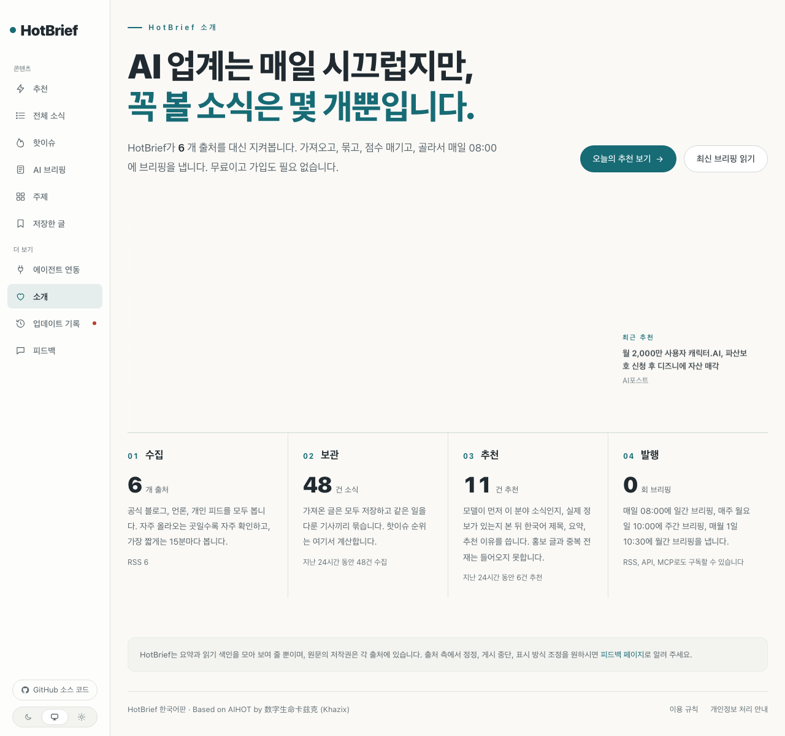

# HotBrief 한국어판

[English](.github/README.md) · **한국어**

출처를 지켜보다가 읽을 만한 AI 소식을 골라 한국어 제목과 요약을 붙이고, 같은 일을 다룬 기사를 하나로 묶어 매일 아침 브리핑을 내는 뉴스 사이트 엔진입니다.

> **Based on [AIHOT](https://github.com/KKKKhazix/AIHOT) by 数字生命卡兹克 (Khazix)** · MIT License · 원본 `LICENSE`, `NOTICE` 는 그대로 두었습니다.
> 바꾼 것: 화면과 모델이 쓰는 글을 한국어(와 미국 영어)로, 중국 전용 의존(위챗 출처, 알리바바 클라우드 임베딩, 중국 글꼴, 베이징 시간)을 한국·미국에서 쓰는 것으로. 자세한 내용은 [`NOTICE.l10n.md`](NOTICE.l10n.md).

```bash
git clone https://github.com/neulketing/hotbrief.git && cd hotbrief && l10n/apply.sh ko && node scripts/init-env.ts --llm-key <모델 API 키> && docker compose up -d --build
```

<http://localhost:3000> 을 열면 됩니다. 관리자 화면은 `/admin`, 비밀번호는 `.env` 의 `ADMIN_PASSWORD` 입니다.

**직접 운영하기 번거롭다면** 저희가 대신 운영하거나 회사 서버에 설치해 드립니다: [요금 안내](https://hotbrief-pricing.neulketing.workers.dev/).


## 실제 화면

로컬에서 한국 언론 네 곳과 해외 공식 출처 두 곳으로 돌린 화면입니다(2026-10-14, 모델 DeepSeek, 임베딩 Gemini). 제목, 요약, 추천 이유는 모두 모델이 한국어로 쓴 것이고, 영어 원문(Google DeepMind, OpenAI)도 한국어로 옮겨 썼습니다.

| 홈(추천) | 기사 상세 |
|---|---|
|  |  |
| **공유 이미지(한글 글꼴)** | **주제 목록** |
|  |  |
| **일간 브리핑(제호 "AI일간")** | **소개** |
|  |  |

## 무엇을 하나

1. **가져오기**: RSS, 웹 목록, JSON API, X 계정 등에서 글을 가져옵니다. 자주 올라오는 출처일수록 자주 확인합니다.
2. **거르기**: 모델이 먼저 이 분야 소식인지, 실제 정보가 있는지 봅니다(예비 선별).
3. **점수 매기기**: 같은 기준으로 두 번 따로 점수를 매기고, 출처 등급별 문턱을 넘은 것만 엄선합니다. 기준과 문턱은 모두 `industry/` 에 공개돼 있습니다.
4. **쓰기**: 한국어 제목, 결론부터 말하는 요약, 추천 이유를 씁니다. 원문에 없는 회사를 제목에 넣지 못하게 막는 장치가 있습니다.
5. **묶기**: 여러 출처가 같은 일을 보도하면 하나의 이슈로 묶고, 독립 출처 수로 열기를 계산해 핫이슈 순위를 만듭니다.
6. **발행**: 매일 08:00(한국 시간) 일간 브리핑, 매주 월요일 주간, 매월 1일 월간 브리핑. RSS, 공개 API, MCP, `llms.txt` 로도 같은 내용을 내보냅니다.

## 한국어판이 바꾼 것

원본 파일은 고치지 않았습니다. 원본 작가가 "여기를 고쳐 쓰라"고 정해 둔 `site/`, `industry/` 를 덮어쓰는 층과, 엔진 코드에 남은 중국어 화면을 고치는 패치를 따로 두고 `l10n/apply.sh` 로 적용합니다. 그래서 원본 업데이트를 계속 받아 올 수 있습니다.

| 위치 | 내용 |
|---|---|
| `l10n/ko/site/site.ts` | 사이트 이름(HotBrief), 홈·소개·브리핑 문구, 발행 시각, `ko-KR` |
| `l10n/ko/industry/prompts/*.md` | 29개 프롬프트 전부. 출력이 한국어가 되게 다시 썼고 규칙·점수·문턱은 그대로입니다 |
| `l10n/ko/industry/taxonomy.ts` | 분류·태그를 한국어로, 네이버·카카오·LG AI연구원·업스테이지·삼성을 회사 목록과 신원 사전에 추가 |
| `l10n/ko/industry/topics.json` | 주제 페이지 43개(한국 회사 5개 추가) |
| `l10n/ko/industry/sources.json` | 한국 AI 뉴스 RSS와 해외 공식 출처 16곳. 2026-10-14에 실제로 열리는지 확인했습니다 |
| `l10n/ko/env.example` | 한국에서 쓰는 설정 예시(`TZ=Asia/Seoul`, Gemini/OpenAI 임베딩) |
| `l10n/patches/ko.patch` | 엔진 코드(`apps/`, `packages/`)에 남은 중국어 화면 문구 번역, 시계를 한국 시간으로, 한국어 문장 세기, 공유 이미지에 한글 글꼴 |
| `l10n/patches/ko-tests.patch` | 테스트(`tests/`)의 기대값을 한국어판 값(분류·화면 문구·한국 시간)으로 맞춤. 한국어판에서도 `npm test` 가 원본과 같은 수로 통과 |
| `l10n/ko/docs/` | 원본 `docs/` 7개 문서의 한국어 번역 |

출처 목록:

| 출처 | 등급 | 주소 |
|---|---|---|
| AI타임스 | T2 언론 | `https://www.aitimes.com/rss/allArticle.xml` |
| 인공지능신문 | T2 언론 | `https://www.aitimes.kr/rss/allArticle.xml` |
| AI포스트 | T2 언론 | `https://www.aipostkorea.com/rss/allArticle.xml` |
| 지디넷코리아 | T2 언론 | `https://feeds.feedburner.com/zdkorea` |
| 블로터 | T2 언론 | `https://www.bloter.net/rss/allArticle.xml` |
| 바이라인네트워크 | T2 언론 | `https://byline.network/feed/` |
| 테크M | T2 언론 | `https://www.techm.kr/rss/allArticle.xml` |
| IT조선 | T2 언론 | `https://it.chosun.com/rss/allArticle.xml` |
| GeekNews | T2 커뮤니티 | `https://news.hada.io/rss/news` |
| NAVER D2 | T1 공식 | `https://d2.naver.com/d2.atom` |
| 카카오 기술 블로그 | T1 공식 | `https://tech.kakao.com/feed/` |
| OpenAI News, Google DeepMind, Hugging Face, NVIDIA | T1 공식 | 원본과 같음 |
| TechCrunch AI | T2 해외 언론 | `https://techcrunch.com/category/artificial-intelligence/feed/` |

## 중국 전용 의존을 어떻게 바꿨나

| 원본 | 한국어판 |
|---|---|
| 위챗 공식계정 출처(유료 Dajiala) | 쓰지 않습니다. RSS·웹 목록·JSON API 출처로 대신합니다 |
| 알리바바 클라우드 DashScope(백련) 임베딩 | OpenAI 호환 임베딩. Google Gemini `gemini-embedding-001`(무료 등급, 실제 호출 확인) 또는 OpenAI `text-embedding-3-small` |
| 중국 모델 예시(Qwen, GLM, MiMo) | 기본은 원본대로 DeepSeek. Gemini 프리셋 추가(`site/models.ts`), OpenAI 설정 예시 |
| 중국 본토 배포 안내(npm 미러, ICP 등록, 해외 출처용 프록시) | 한국 서버에서는 필요 없습니다. `docker compose up -d --build` 그대로 |
| 페이수(Feishu) 알림·로그인 | 꺼 둡니다. 경보는 `docker compose logs worker` 로 봅니다 |
| Noto Sans SC(공유 이미지, 브리핑 제호) | Noto Sans KR. `apply.sh ko` 가 고정 버전을 받아 해시를 확인하고, 제호 SVG는 `l10n/tools/nameplates.ts` 로 다시 만들었습니다 |
| 베이징 시간(UTC+8) | 한국 시간(UTC+9). 한국은 서머타임이 없어 원본의 고정 시차 방식을 그대로 씁니다 |
| 백업 기본 주소 텐센트 COS | AWS S3, Cloudflare R2, 네이버클라우드 등 S3 호환 저장소 주소를 `DB_BACKUP_STORE_DOMAIN` 에 적습니다 |

한국 언론 RSS 상당수가 시간대 없는 시각(`2026-10-14 18:23:32`)을 줍니다. 원본 엔진은 이를 서버 시간대로 읽어 Docker(UTC)에서 9시간 어긋나는데, 패치가 한국 시간으로 읽게 고칩니다. 패치 없이(`--overlay`) 쓴다면 `.env` 에 `TZ=Asia/Seoul` 을 넣으세요.

원본에 없던 문제도 하나 고쳤습니다. Google Gemini 의 OpenAI 호환 임베딩 응답에는 `index` 가 없어서 원본 엔진이 응답을 버렸습니다. 패치는 이때 목록 순서를 그대로 씁니다(실제 Gemini 호출로 확인).

## 설치

필요한 것: Docker(Compose 포함), Node.js 24 이상(`init-env` 실행용), OpenAI 호환 모델 API 키 하나(DeepSeek, Gemini, OpenAI 등).

```bash
git clone https://github.com/neulketing/hotbrief.git
cd hotbrief
l10n/apply.sh ko                              # 한국어판 덮어쓰기 + 패치 + 한글 글꼴
node scripts/init-env.ts --llm-key <키>       # .env 생성(무작위 비밀값, 관리자 비밀번호 출력)
docker compose up -d --build
```

- 기본 모델은 DeepSeek입니다. Gemini나 OpenAI를 쓰려면 `.env` 의 `LLM_BASE_URL`, `LLM_MODEL`, `LLM_EXTRA_JSON` 을 예시대로 바꿉니다.
- 엔진 코드는 건드리지 않고 문구·출처·프롬프트만 바꾸려면 `l10n/apply.sh ko --overlay`. 이 경우 화면 일부와 시계(베이징 시간)는 원본 그대로입니다.
- 원래대로 돌리려면 `l10n/apply.sh revert`(= `git checkout HEAD -- site industry .env.example apps packages tests`).
- Docker 없이 돌리기, 도메인과 HTTPS, 백업은 원본과 같습니다. 한국어 번역 [`l10n/ko/docs/deploy.md`](l10n/ko/docs/deploy.md)(원문 [`docs/deploy.md`](docs/deploy.md), 중국어). 다른 문서도 [`l10n/ko/docs/`](l10n/ko/docs/)에 있습니다.

## 내 분야로 바꾸기

원본과 같습니다. 바꿀 곳은 거의 다 `site/` 와 `industry/` 입니다. 한국어판 파일(`l10n/ko/...`)에서 시작해 고친 뒤 다시 `apply.sh` 로 복사하거나, 적용된 파일을 바로 고치면 됩니다.

코딩 에이전트(Claude Code, Codex 등)에게 이렇게 맡기면 됩니다.

```text
AGENTS.md, l10n/ko/docs/customize.md, README.ko.md를 읽고 이 사이트를 "OO" 분야 뉴스 사이트로 바꿔 줘.
l10n/ko/ 아래 파일을 고치고 l10n/apply.sh ko로 적용해.
내가 신경 쓰는 것: …(볼 출처, 중요한 소식과 아닌 소식, 구체적일수록 좋다)
끝나면 npm run typecheck, npm test, node scripts/smoke.ts를 돌리고, 아직 내가 정해야 할 것을 알려 줘.
```

가장 공들일 곳은 평가 기준(`industry/prompts/selection-score.md`)과 문턱(`industry/selection.ts`)입니다. 직접 라벨을 붙인 기사 100~200개로 `scripts/eval-selection.ts` 를 돌려 보고 고치세요.

## 검증

2026-10-14 에 이 저장소에서 돌린 결과입니다.

| 확인 | 결과 |
|---|---|
| `npm run typecheck` (한국어판·영어판 각각 덮어쓰기+패치) | 통과 |
| `node scripts/smoke.ts` (한국어판 실제 사이트, 영어판 실제 사이트) | 둘 다 all checks passed |
| `npm test` 원본 그대로 | 761개 중 760개 통과(1개는 이 컴퓨터의 네트워크 프록시 테스트) |
| `npm test` 한국어판 덮어쓰기만 | 749개 통과. 실패 12개는 원본 AI 예시의 중국어 태그·주제·제목을 고정값으로 확인하는 테스트 11개와 위 프록시 테스트 |
| `npm test` 한국어판 덮어쓰기+패치 | 731개 통과. 실패 30개는 위와 같은 고정값, 중국어 화면 문구, 베이징 시간(UTC+8)을 전제로 한 테스트 |

원본 `AGENTS.md` 도 "분류를 바꾸면 `tests/` 의 예시도 새 분야 것으로 바꾸라"고 적어 두었습니다. HotBrief 는 원본 파일을 고치지 않기로 했기 때문에 테스트는 원본 그대로 두었습니다.

## 원본 업데이트 따라가기

```bash
git remote add upstream https://github.com/KKKKhazix/AIHOT.git   # 한 번만
l10n/apply.sh revert
git fetch upstream && git merge upstream/main
l10n/apply.sh ko        # 패치가 안 맞으면 git apply --3way l10n/patches/ko.patch로 맞춘 뒤 패치를 다시 만든다
```

엔진 코드에 남은 중국어 문구 목록은 `node l10n/tools/zh-inventory.ts <원본 폴더> <적용한 폴더>` 로 다시 뽑을 수 있습니다. 현재 목록은 [`l10n/zh-inventory.md`](l10n/zh-inventory.md).

## 라이선스

코드는 [MIT License](LICENSE)(원본 저작권: 数字生命卡兹克). "AIHOT" 이름과 로고는 MIT 범위 밖이라 HotBrief는 이를 이름이나 로고로 쓰지 않습니다. 글꼴 라이선스는 [`NOTICE`](NOTICE)와 [`NOTICE.l10n.md`](NOTICE.l10n.md).
