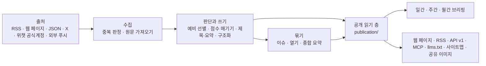

# 아키텍처
> 원본 [docs/architecture.md](../../../docs/architecture.md)(AIHOT, 중국어, 커밋 b868d38)의 한국어 번역입니다. 한국어판에서 바뀌는 부분은 [README.ko.md](../../../README.ko.md)를 보세요.



## 세 개의 프로세스

| 프로세스 | 위치 | 하는 일 |
|---|---|---|
| api | `apps/api/` | Fastify. 사이트 자체용 API(`/api/site/`), 공개 API(`/api/v1/`), RSS, MCP, 관리자 화면 API, 이미지 프록시, 공유 이미지 |
| worker | `apps/worker/` | pg-boss 작업 큐와 예약 작업: 출처 가져오기, 모델 호출, 묶기, 열기, 일간 브리핑, 경보, 정리 |
| web | `apps/web/` | React Router 서버 렌더링 웹 페이지. HTTP 로만 api 를 읽고 데이터베이스는 건드리지 않습니다 |

업무 코드는 모두 `packages/backend/` 에 있고, 프런트엔드와 백엔드가 같이 쓰는 타입과 상수는 `packages/contracts/` 에 있습니다. 이 사이트 고유의 이름, 문구, 브랜드, 페이지는 `site/` 에, 업종의 분류, 출처, 프롬프트, 문턱은 `industry/` 에, 이 사이트에만 있는 기능은 `modules/` 에 둡니다(아래 "모듈" 참고).

## 바뀌지 않는 몇 가지 규칙

- **공개 읽기 층은 하나**: 웹 페이지, RSS, API, MCP, 사이트맵, 공유 이미지는 모두 `packages/backend/src/publication/` 을 읽습니다. 공개 범위, 엄선 자리(기계용 출구는 뉴스 하나에 한 건만 냅니다), 사실 증거 조건은 `publication/scope.ts` 에서만 정합니다. 새 출구도 현재의 철회와 전문 허락 규칙을 따릅니다. 이미 발행한 브리핑은 그 호에 쓴 글을 그대로 두지만, 인용을 공개할 수 있는지, 출처 이름, 인용 시각은 현재 자료로 판단합니다. 철회할 때는 그 인용에 기대는 안내문과 표지도 함께 뺍니다.
- **캐시가 옛 내용의 수명을 늘리지 않음**: 바뀔 수 있는 내용은 응답의 `Cache-Control` 이 끝나면 다시 검증합니다. 사이트맵의 프로세스, 디스크, HTTP 캐시는 같은 마감 시각을 쓰고, 보낼 때 시간을 다시 재지 않습니다. MCP 의 HTTP 응답은 `no-store` 를 씁니다. 직접 둔 프록시나 CDN 도 같은 규칙을 지켜야 합니다. 설정 요건은 [배포](deploy.md#도메인과-https-설정)의 "도메인과 HTTPS 설정"을 보세요.
- **페이지는 모델을 부르지 않음**: 독자가 페이지를 열면 데이터베이스에 이미 있는 결과만 읽습니다. 모델은 worker 의 작업 안에서만 부릅니다.
- **돈이 드는 요청에는 영수증이 있음**: 유료 요청(모델, X, 위챗 공식계정, Jina)마다 먼저 영수증을 한 장 남기고, 결과를 받으면 먼저 저장한 뒤 씁니다. 프로세스가 다시 시작하거나 작업을 다시 시도할 때는 이미 돈을 낸 결과를 다시 써서 돈을 두 번 쓰지 않습니다(`providers/receipts.ts`). 결과가 불분명한 영수증은 30분이 지나면 한 번 자동으로 풀어 줍니다. 그 영수증 때문에 실패 상태에 멈춘 글은 다시 큐에 넣어, 끝내지 못한 본문 추출이나 분석을 이어 갑니다. 또 결과가 불분명하면 관리자가 "실행" 페이지에서 확인한 뒤 풀어 줍니다.
- **예산 차단기**: 유료 서비스마다 분당, 시간당, 하루 한도가 있고, 넘으면 멈춥니다(관리자 화면 "설정 → 유료 요청 한도").
- **안전밸브**: `COLLECT_ENABLED`, `MODEL_CALLS_ENABLED`, `FEISHU_CONTENT_PUSH_ENABLED`, `FEISHU_INTERNAL_ENABLED`, `INDEXNOW_SUBMIT_ENABLED` 는 "내보낼지 말지"만 정하고, 어떤 로직을 탈지는 정하지 않습니다. `true` 로 둘 때만 켜지고, 적지 않으면 꺼져 있습니다. `scripts/init-env.ts` 가 만드는 `.env` 는 수집과 모델 호출을 켭니다. 화면만 손볼 때는 `false` 로 바꿔도 됩니다. 테스트에서는 푸시가 늘 꺼져 있고, 수집과 모델 호출은 로컬 가짜 서비스에만 연결합니다.
- **공개 내용은 익명**: 관리자와 방문자가 보는 내용이 같습니다. 독자의 즐겨찾기와 읽음 표시는 브라우저에 저장합니다. 관리자 화면은 관리자만 들어갑니다.
- **옛 글이 화면을 덮지 않음**: 발견했을 때 이미 발행된 지 48시간이 넘은 자료, 새 출처를 처음 가져올 때의 기존 글, 거슬러 채운 푸시는 원문 시각으로 보관하고, "오늘"에 넣지 않으며 푸시하지 않습니다. 처음 가져온 뒤로는 목록에 있는 더 이른 기존 글을 받지 않습니다. 믿을 만한 발행 시각이 없는 자료는 일단 공개하지 않고, 날짜를 읽은 뒤 새 글인지 옛 글인지 판단합니다.
- **출처를 따라갈 수 있음**: 엄선된 글은 모두 원문에 링크합니다. 사이트 안에서 전문을 보여 줄지는 출처의 `site_fulltext` 가 정하고, 기본은 요약만 보여 줍니다.
- **규칙은 그 규칙이 속한 모듈이 관리**: 관리자 화면은 콘텐츠, 이슈, 알림, 복구 모듈을 부르고, 그 상태를 직접 고쳐 쓰지 않습니다. 업무 모듈은 거꾸로 관리자 화면에 기대지 않습니다. 사람이 고친 내용은 공개 결과, 복구에 필요한 기록과 함께 한 번에 반영합니다.
- **프로세스를 넘는 API 는 타입을 공유**: 관리자 화면 API 는 `packages/contracts/src/admin.ts` 를, 작업 페이로드는 `jobs/queue.ts` 의 `JobData` 를 기준으로 삼고, 보내는 쪽과 받는 쪽을 함께 검사합니다. 프런트엔드는 여전히 HTTP 로만 백엔드에 접근합니다.

이 모듈 경계는 `tests/architecture.test.ts` 가 검사합니다. 경계를 바꿀 때는 약속과 검사를 같이 고칩니다. 사이트 정체성과 단계마다의 모델은 `site/` 에서, 업종 분류와 프롬프트는 `industry/` 에서 읽고, 어떤 사이트의 값도 코드에 박아 두지 않습니다.

## 디렉터리

| 위치 | 내용 |
|---|---|
| `site/` | 이 사이트 고유의 것: 사이트 이름과 문구, 단계마다의 모델, 브랜드와 로고, 약관 페이지, 웹사이트 루트의 고정 파일 네 개(`public/`, 자리표시자를 바꾼 뒤 발행), 업데이트 기록, 켤 모듈(`site/modules/`) |
| `industry/` | 업종 꾸러미: 분류 태그, 주제, 예시 출처, 프롬프트, 문턱 |
| `modules/` | 이 사이트에만 있는 기능. 기능 하나에 폴더 하나(아래 "모듈" 참고). 프레임워크 자체에는 모듈이 들어 있지 않습니다 |
| `packages/backend/src/sources/` | 여섯 가지 출처의 읽기 도구, 가져오기 일정 관리(`collect.ts`) |
| `packages/backend/src/content/` | 자료 저장, 중복 판정, 본문 추출과 정리 |
| `packages/backend/src/editorial/` | 판단과 쓰기: `analyze.ts`(흐름), `prompts.ts`(프롬프트 읽기), `models.ts`(단계마다 어떤 모델을 쓸지) |
| `packages/backend/src/events/` | 이슈 묶기, 열기, 이슈 종합 요약 |
| `packages/backend/src/publication/` | 공개 읽기 층 |
| `packages/backend/src/reports/` | 일간, 주간, 월간 브리핑 |
| `packages/backend/src/providers/` | 모델, 벡터, X, 위챗 공식계정, Jina 호출, 영수증과 예산 |
| `packages/backend/src/notify/` | Feishu 푸시 |
| `packages/backend/src/operations/` | 경보, 백업, 정리, IndexNow |
| `packages/backend/src/admin/` | 관리자 화면 API |
| `apps/web/app/routes/` | 페이지 하나에 파일 하나. 라우트 표는 `apps/web/app/routes.ts` |
| `database/migrations/` | 데이터베이스 마이그레이션. 전체 파일 이름 순서로 실행하고 기록합니다 |
| `scripts/` | 초기화, 마이그레이션, 시드 데이터, 평가, 검사 스크립트 |
| `tests/` | 백엔드 테스트(데이터베이스 이름은 `_test` 나 `_ci` 로 끝나야 합니다. 아래 참고) |

## 모듈

프레임워크에는 없고 내 사이트에만 필요한 기능(예: 전용 순위표나 모니터링 페이지)은 모듈로 만듭니다. 기능 하나에 폴더 하나 `modules/<이름>/` 이고, `@aihot/<이름>` 라는 이름의 npm 패키지입니다. 그 안에 자기 백엔드, API, 페이지, 스타일, 데이터베이스 마이그레이션, 테스트를 담습니다.

| 파일 | 내용 |
|---|---|
| `module.ts` | 모듈의 주소: 페이지, 리디렉션, api 가 처리할 경로(타입은 `packages/contracts/src/modules.ts`) |
| `server.ts` | 백엔드에 꽂는 소켓: API, 예약 작업, 큐, 이벤트 콜백, 관리자 화면 페이지의 데이터 등(`packages/backend/src/modules.ts`, 소켓마다 그것을 읽는 파일을 적어 둠) |
| `web.tsx` | 웹 페이지에 꽂는 소켓: 페이지, 내비게이션 항목, 주제 페이지와 관리자 화면의 부품 등(`apps/web/app/modules.ts`). 한 페이지에만 나오는 부품은 로딩 함수를 주어 그 페이지 코드와 함께 불러옵니다 |
| `migrations/` | 모듈 자신의 테이블. `database/migrations/` 와 함께 파일 이름 순서로 실행합니다 |
| `tests/` | 모듈의 테스트. `npm test` 로 같이 돌립니다 |
| 그 밖의 파일 | 모듈 자신의 이미지 같은 정적 파일도 모듈 폴더에 둡니다. `server.ts` 의 `http` 소켓에 라우트를 등록하고 `apps/api/src/routes/static.ts` 의 `sendFile` 로 보냅니다(타입, ETag, 캐시 헤더, 404 는 이 함수가 처리하고, 파일 이름은 직접 검증합니다). 주소는 `module.ts` 의 `apiPaths` 에 적습니다 |

다 만들었으면 `site/modules/` 의 목록 세 개에 올립니다. `index.ts` 에는 주소를, `server.ts` 에는 백엔드를, `web.ts` 에는 웹 페이지를 적고, 없는 부분의 목록에는 적지 않습니다. 그다음 `site/package.json` 의 `dependencies` 에 모듈을 적습니다. Docker 로 배포한다면 `Dockerfile` 에 다른 패키지처럼 `COPY modules/<이름>/package.json modules/<이름>/` 한 줄을 넣습니다. 프레임워크 코드는 어떤 모듈도 가져오지 않고 이 세 목록만 읽습니다. 그래서 이 저장소의 업데이트를 합쳐도 내 기능과 잘 부딪히지 않습니다. 소켓이 모자라면 이 기능을 프레임워크에 넣지 말고, 프레임워크에 범용 소켓을 하나 더합니다.

모듈은 `agent.abilities` 로 MCP 도구를 제공합니다. `scripts/mcp-check.ts` 는 언제나 전체 도구 집합을 검사합니다. 모듈은 `mcp.checkArgs` 에 빈 데이터베이스에서도 성공하는 검사 인자를 줄 수 있습니다. 주지 않으면 입력 schema 가 `{}` 를 받는 도구만 `{}` 로 실제 호출하고, 나머지 도구는 발견만 검사하며 인자를 짐작하지 않습니다. 모듈 도구의 업무 동작은 모듈 자신의 테스트로 검증합니다.

## 데이터베이스 마이그레이션

이미 발행한 마이그레이션은 배포 이력이라서 고쳐 쓰거나 지울 수 없습니다. 수정은 새 파일에 넣습니다. 엔진과 모듈의 마이그레이션은 같은 약속을 따릅니다. 전체 파일 이름 순서로 실행하고, 실행했는지는 전체 파일 이름으로 기록합니다. 번호가 같은 다른 파일은 따로 실행하고, 같은 전체 파일 이름이 두 디렉터리에 함께 있을 수 없습니다. `0055` 부터는 파일마다 온라인으로 실행해도 되는 문장 하나만 넣습니다. PR 은 이 약속에 맞지 않는 새 마이그레이션을 거부하고, 더 작은 번호로 검사를 피하는 것도 허용하지 않습니다. 앞 문장이 테이블을 잠근 채, 같은 트랜잭션 안에서 다른 테이블을 기다리거나 많은 데이터를 훑는 일을 막기 위해서입니다.

새 열은 되도록 null 을 허용하는 열이나 상수 기본값을 씁니다. 기존 테이블에 CHECK, 외래 키를 더할 때는 먼저 `NOT VALID` 로 넣고, 다른 마이그레이션에서 검증합니다. 인덱스는 따로 `CREATE INDEX CONCURRENTLY IF NOT EXISTS` 를 씁니다. 발행하는 마이그레이션에서 대량 UPDATE, DELETE 를 하거나 DO 로 그것을 숨겨서는 안 됩니다. 데이터 채우기는 나눠서 진행 상황을 볼 수 있는 별도 작업으로 하고, 먼저 백업 사본에서 검증합니다.

여러 필터 조건이 서로 관련 있어서 쿼리 계획이 행 수를 크게 낮춰 잡을 때는, 그 열들에 MCV 결합 통계를 만들고, 별도 마이그레이션으로 지정한 테이블의 그 열들을 `ANALYZE` 할 수 있습니다. 먼저 실제 분포로 효과를 검증합니다. 근거 없는 통계 객체를 더하지 않고, 마이그레이션에서 데이터베이스 전체를 분석하거나 잠긴 테이블을 건너뛰고 성공했다고 가정하지도 않습니다.

타입 변경, 열 삭제 같은 파괴적 변경은 업그레이드와 롤백 단계를 따로 설계하고, 기존 데이터에 미치는 영향을 [배포 문서](deploy.md#업데이트)에 적습니다. 지금의 온라인 마이그레이션 검사는 이런 변경을 바로 통과시키지 않습니다. 코드가 더는 쓰지 않는 테이블은 데이터를 지워도 된다고 확인한 뒤, 마이그레이션 파일 하나에 따로 `DROP TABLE IF EXISTS <테이블>` 를 적습니다(CASCADE 는 붙이지 않습니다. 아직 그 테이블에 기대는 객체가 있으면 마이그레이션이 실패합니다). 이것도 배포 문서에 적습니다. 허용하는 문장을 늘려야 하면, 먼저 그 문장이 서비스 중인 요청을 오래 막지 않는다는 것을 증명하고 해당 검사를 채워 넣습니다. 검사를 끄거나 옛 기록을 고쳐서는 안 됩니다.

## 외부 출구

이슈의 `related` 연결은 만들 때 최소 두 개의 보도가 뒷받침해야 합니다. 연결 이력은 남깁니다. 다리 역할을 하던 보도가 명시적으로 철회되거나, 공개 사실 보도 자격을 잃거나, 종합 기사로 바뀌거나, 원래 사실에서 빠지거나, 이후의 묶기 판단이 관계를 부정해서 유효한 증거가 두 개보다 적어지면 공개하지 않습니다. 증거가 다시 충분해지면 다시 보여 줄 수 있습니다. 보도가 자연스럽게 재조회 범위를 벗어나거나, 소속을 그대로 이어 가는 일반 수정으로는 연결이 만료되지 않습니다. 확인할 수 있는 다리 판단이 없는 기존 연결은 기록이 없다는 이유로 철회되었다고 추론하지 않습니다. 이슈 자체를 공개로 읽을 수 없을 때는 여전히 추천하지 않습니다. `storyline` 의 의미는 이 규칙 때문에 바뀌지 않고, 모든 공개 출구가 같은 읽기 규칙을 씁니다.

| 주소 | 내용 |
|---|---|
| `/` `/all` `/hot` `/topics` `/daily` `/weekly` `/monthly` | 엄선, 전체 소식, 핫이슈, 주제, 일간·주간·월간 브리핑 |
| `/feed.xml` `/feed/full.xml` `/feed/all.xml` `/feed/daily.xml` `/feed/weekly.xml` `/feed/monthly.xml` | RSS: 엄선, 엄선 전문, 전체, 일간, 주간, 월간 브리핑. 분류별 `/feed/category/<key>.xml` 과 분류 전문판 `/feed/full/category/<key>.xml` 도 있습니다 |
| `/api/v1/` | 공개 API. 문서는 `/openapi-v1.json` 에 있습니다. Agent 가 읽을 Markdown 은 `/api/v1/agent` 에서 시작하고, 설명 페이지는 `/agent` 입니다 |
| `/api/mcp` | MCP 서비스: 최신, 검색, 핫이슈, 이슈, 일간·주간·월간 브리핑마다 도구가 하나씩 있습니다. 도구 이름 접두사는 `site/site.ts` 의 `mcpPrefix` 입니다 |
| `/llms.txt` `/sitemap.xml` `/robots.txt` | 대형 모델과 검색 엔진을 위한 안내(`robots.txt` 같은 루트 파일은 `site/public/` 에 있습니다) |
| `/admin` | 관리자 화면 |

## 테스트

```bash
npm run typecheck
DATABASE_URL=postgres://127.0.0.1:5432/myhot_test npm test
npm run build -w @aihot/web && node --test apps/web/tests/*.test.ts
```

`DATABASE_URL` 이 가리키는 데이터베이스 이름은 `_test` 나 `_ci` 로 끝나야 합니다. 없으면 자동으로 만들고 마이그레이션합니다. 테스트 파일마다 그 데이터베이스의 사본 하나에서 병렬로 돌기 때문에, 데이터베이스 계정에 데이터베이스를 만들 권한(`CREATEDB`)이 있어야 합니다. 테스트는 어떤 외부 서비스에도 접속하지 않습니다. 모델과 유료 API 는 모두 로컬 가짜 서비스가 답합니다.
